<p align="center">
  <a href="https://www.yousifdev.com"></a>
</p>

<p align="center">
  <a href="https://www.yousifdev.com"></a>
  <a href="https://www.linkedin.com/in/youssif-mohamed-450795157/"></a>
  <a href="https://www.instagram.com/yousifdev_/"></a>
  <a href="https://www.tiktok.com/@yousifdev_"></a>
  <a href="https://www.youtube.com/@ProgrammingInTheKitchen"></a>
  <a href="https://codeforces.com/profile/yousifm836"></a>
</p>

<table>
<tr>
<td valign="top">

###  Meet the chef

I'm **Yousif**, a Senior Full-Stack Developer and Technical Lead in **Muscat, Oman**. By day I lead the build of a GCC healthcare licensing platform. The rest of the time I teach developers how to ship real software with AI without losing the engineering.

- 🍳 **Cooking now:** NURSEL, an ASP.NET 10 + Angular 21 platform with 700+ automated tests
- 🧑‍🏫 **Teaching:** senior full-stack and AI-augmented development at Advanced Academy
- 🤖 **House special:** Spec-Driven Development with a customized Spec Kit, Claude Code and Codex
- 🎬 **On camera:** Arabic programming content as *Joonguini, Programming in the Kitchen*
- 📬 **Book a table:** [yousifdev.com/contact](https://www.yousifdev.com/contact)

</td>
<td width="250" align="center" valign="middle">

</td>
</tr>
</table>

```ts
const chef = {
  name: "Yousif Mohamed Ibrahim",
  alias: "Joonguini",
  kitchen: "Muscat, Oman",
  roles: ["Technical Lead", "Senior Full-Stack Developer", "AI-Augmented Development Instructor"],
  cookingSince: 2019,
  studentsServed: "100+",
  placementRate: "70%",
  languages: ["Arabic (RTL)", "English (LTR)"],
  recipe: () => "spec first, code second, tests always",
  hobbies: ["Gym", "Reading", "Staying up all night chasing that ONE BUG..."],
};
```

##  The pantry

Everything on the shelf, grouped by where it goes in the dish.

**Backend**


**Frontend and mobile**


**Databases**

 &nbsp; plus Oracle and SQL Server

**DevOps and cloud**


**AI-augmented development**


**Architecture and security**

`Clean Architecture` `CQRS / MediatR` `Microservices` `N-Tier` `HLD / LLD` `State machines` `RBAC` `OAuth2 / OIDC / JWT` `WebSocket` `Thawani payments`

##  Signature dishes

Click a dish to see what went into it.

<details open>
<summary><b>NURSEL</b> · GCC nursing assessment and licensing platform · <i>in active delivery</i></summary>
<br/>

Technical Lead. I own the architecture and the delivery.

- ASP.NET 10 backend on Clean Architecture with a MediatR (CQRS) pipeline over PostgreSQL
- Contract-versioned API: 45+ operations and 700+ automated tests
- Exam-eligibility and payment-obligation state machine with Thawani payments
- Python MRZ service that verifies passports and IDs during onboarding
- Angular 21 frontend (signals, standalone components), Arabic RTL and English LTR

`ASP.NET 10` `MediatR` `PostgreSQL` `Angular 21` `Python` `Thawani`
</details>

<details>
<summary><b>Al Wasl Private School</b> · school platform with a PWA portal · <i>in deployment</i></summary>
<br/>

Monorepo with a public site and a PWA portal: real-time messaging, offline-sync attendance, GPS bus tracking with geofencing, and bilingual role-based access.

`Django` `DRF` `WebSocket` `PostgreSQL` `Redis` `FCM` `PWA`
</details>

<details>
<summary><b>Al Amani Medical Center</b> · booking and pharmacy platform · <i>in deployment</i></summary>
<br/>

Full SRS and build for an MOH-licensed medical center: bilingual platform with appointment booking, an e-commerce pharmacy and Thawani payments.

`Next.js 14` `Prisma` `PostgreSQL` `Thawani` `Cloudinary`
</details>

<details>
<summary><b>Capital Academy</b> · e-learning platform · <i>live at <a href="https://capitalacad.com">capitalacad.com</a></i></summary>
<br/>

Business analysis, SRS and architecture for an e-learning platform with Thawani payments.

`Django` `PostgreSQL` `Thawani`
</details>

<details>
<summary><b>Dhofar Governorate</b> · meeting management and IT service desk systems</summary>
<br/>

- **Meeting Management System:** .NET 10 backend (12 modules, 5-status request state machine, room-availability validation) with an Angular 20 and PrimeNG frontend
- **Service Desk:** .NET 10 on Clean Architecture with JWT and 4-role RBAC, plus an Angular frontend with real-time notifications

`.NET 10` `EF Core` `Angular 20` `PrimeNG` `SQL Server`
</details>

<details>
<summary><b>MK Tradings</b> · medical equipment e-commerce</summary>
<br/>

Full e-commerce platform with catalog, inventory, cart, secure checkout and AWS deployment.

`MongoDB` `Express.js` `React` `Node.js` `AWS`
</details>

##  Kitchen history

| When | Role | Where |
| --- | --- | --- |
| Jun 2026 to now | **Technical Lead and Senior Full-Stack Developer** | NURSEL SPC |
| Jun 2026 to now | **Senior Full-Stack and AI-Augmented Development Instructor** | Advanced Academy, Muscat |
| Feb 2026 to Apr 2026 | **Technical Trainer and Full-Stack Developer** (contract) | Code Academy, Office of the Governor of Dhofar |
| Nov 2023 to Jan 2026 | **Head of Bootcamps Department and Full-Stack Developer** | Code Academy, Muscat |
| May 2019 to now | **Full-Stack Developer** | Self-employed, Oman |

##  Cooking classes

- Led **3 government-sponsored Makeen bootcamps** with Oman's Ministry of Transport, Communications and Information Technology: **100+ developers trained, 70% job placement**
- Designed a 19-lecture **Angular 17+ program** (80 to 120 hours) for government IT staff
- Trained **Oman's national teams for OCPC 2025** and co-organized the national programming competition
- Course: [**AI-Augmented Development: From Spec to Production**](https://www.yousifdev.com/courses/ai-augmented-development-from-spec-to-production)
- Free guide: [**Prompt Engineering for Developers**](https://www.yousifdev.com/prompt-books/prompt-engineering-for-developers)
- Watch: [Instagram](https://www.instagram.com/yousifdev_/) · [TikTok](https://www.tiktok.com/@yousifdev_) · [YouTube](https://www.youtube.com/@ProgrammingInTheKitchen) · [Blog](https://www.yousifdev.com/blog/srs-document-that-makes-ai-augmented-development-work)

##  On the wall

| | |
| --- | --- |
| 🏅 **Claude Code Certification** | Anthropic, 2025 |
| 🏅 **PMI Ready** | Project Management Institute, 920/1000, 2024 |
| 🏅 **No-Code AI and Machine Learning** | MIT Professional Education, 80 hours, 2025 |
| 🎓 **B.Sc. Computer Science** | Arab Academy for Science, Technology and Maritime Transport |
| 🎓 **Full-Stack Development using Python** | Information Technology Institute (ITI), Egypt |
| 🏆 **Competitive programming** | ECPC 2020 and ACPC 2020 (Africa and Arab Championship) |

##  Kitchen heat

<p align="center">
  
</p>
<p align="center">
  
</p>

---

<p align="center">
  <b>Hungry for more?</b> Courses, writing and a way to reach me are all at <a href="https://www.yousifdev.com">yousifdev.com</a>.<br/>
  <sub>Made in the kitchen with spec first, code second.</sub>
</p>
